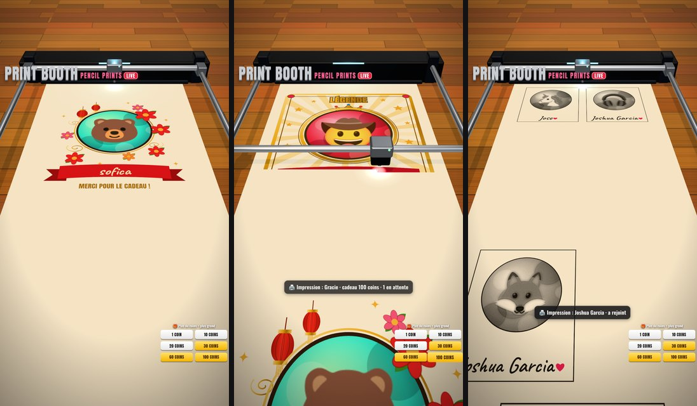

# 🖨️ Print Booth Live — Empira Studio

Un live TikTok interactif : une **imprimante 3D dessine en direct la photo de profil** de tes
spectateurs. Chaque arrivée, follow, commentaire ou cadeau ajoute la personne à la
« file d'impression ». Les **cadeaux passent devant** et donnent des impressions plus grandes
et décorées (jusqu'à la carte « Légende » pleine page à 100 coins).



> Le cahier des charges complet (le « prompt idéal ») est dans [`PROMPT.md`](PROMPT.md).

---

## Installation sur PC Windows (une seule fois)

1. **Installe Node.js** (gratuit) : va sur <https://nodejs.org/fr/download>, prends la version
   **LTS**, installe-la avec les options par défaut, puis **redémarre le PC**.
2. **Télécharge ce dossier** : sur la page GitHub du projet, bouton vert **Code → Download ZIP**,
   puis clic droit sur le fichier ZIP → **Extraire tout…** (par exemple dans `Documents`).
3. Ouvre le dossier extrait et **double-clique sur `LANCER-WINDOWS.bat`**.
   - Si Windows affiche « Windows a protégé votre ordinateur » : *Informations complémentaires*
     → *Exécuter quand même*.
   - La première fois, il télécharge les composants (1 à 2 minutes).
4. Le **tableau de bord** s'ouvre dans ton navigateur (`http://localhost:3737`).
   Une fenêtre noire reste ouverte : **ne la ferme pas** pendant le live.

**Sur Mac** : même chose avec `LANCER-MAC.command` (la première fois : clic droit → *Ouvrir*).

## Ajouter l'overlay dans TikTok LIVE Studio

1. Dans le tableau de bord, clique sur **Copier** à côté de l'adresse `http://localhost:3737/overlay`.
2. Dans **TikTok LIVE Studio** : *Ajouter une source* → **Lien** (« Link ») → colle l'adresse.
3. Taille **1080 × 1920** (format vertical), puis étire la source pour qu'elle remplisse l'écran.

Avec **OBS Studio** : *Sources* → **+** → **Navigateur** → URL `http://localhost:3737/overlay`,
largeur `1080`, hauteur `1920`, coche *Contrôler l'audio via OBS* pour entendre l'imprimante.

## Avant chaque live : le test (2 minutes)

1. Lance `LANCER-WINDOWS.bat`.
2. Dans le tableau de bord, partie **3 · Tester**, clique sur *Follow*, *Commentaire*,
   *🎁 30 coins*… L'overlay doit imprimer les portraits. Tout marche ? Clique sur
   **Effacer le papier**.
3. Lance ton live sur TikTok, puis dans **1 · Connexion**, tape ton `@pseudo` et clique sur
   **Se connecter**. Le pseudo est mémorisé : les fois suivantes, la connexion est automatique
   (et se relance toute seule si le live coupe).

## Comment ça marche pendant le live

| Action du spectateur | Ce qui est imprimé |
|---|---|
| Arrivée, follow, partage, commentaire | Petit croquis au crayon |
| Cadeau **1 coin** | Croquis au crayon (prioritaire) |
| Cadeau **10 coins** | Grand croquis au crayon |
| Cadeau **20 coins** | Portrait couleur |
| Cadeau **30 coins** | **Pleine page** « fête » : lanternes, fleurs, bannière |
| Cadeau **60 coins** | **Pleine page** « royal » : cadre doré, couronne, lauriers |
| Cadeau **100 coins** | **Pleine page** « Légende » : rayons dorés, étoiles, bannière |

- Les cadeaux passent devant tout le monde (les plus gros d'abord).
- Un spectateur n'est jamais deux fois dans la file ; ses cadeaux **s'additionnent** tant qu'il
  attend (9 roses = 9 coins).
- Une personne déjà imprimée ne revient qu'après 10 minutes (sauf si elle envoie un cadeau).
- La file n'avance que si l'overlay est ouvert (aperçu ou TikTok LIVE Studio).

Dans le tableau de bord tu peux : mettre en **pause**, **retirer** quelqu'un, le faire
**imprimer maintenant** (⬆️), **avancer le papier**, **effacer le papier**, **vider la file**.

## Réglages

Tout se règle dans le tableau de bord (partie *Réglages* → **Enregistrer**) :
événements imprimés, mot-clé obligatoire dans les commentaires (ex. « dessine »), seuil de likes,
délai anti-spam, taille de la file, paliers de coins, vitesse, langue de l'overlay (FR/EN),
sons, titre / sous-titre / badge du logo.

Les réglages sont enregistrés dans `config.json` (créé au premier lancement, jamais écrasé
par une mise à jour). Pour revenir aux réglages d'usine : supprime `config.json`.
Réglages avancés possibles uniquement dans ce fichier : `port`, taille (`size`), durée
(`seconds`) et style (`pencil`, `color`, `festive`, `royal`, `legend`) de chaque palier.

## Problèmes fréquents

- **« n'est pas en live »** : lance d'abord le live sur TikTok ; l'app réessaie toute seule.
- **La file n'avance pas** : l'overlay n'est pas ouvert, ou tu as mis la pause.
- **Pas de photo, juste une initiale** : TikTok n'a pas fourni la photo ; l'impression a quand
  même lieu avec un avatar de remplacement.
- **« Le port 3737 est déjà utilisé »** : Print Booth est déjà ouvert dans une autre fenêtre.
- **L'overlay reste noir dans TikTok LIVE Studio** : vérifie que la fenêtre noire est ouverte,
  puis essaie l'adresse `http://127.0.0.1:3737/overlay` à la place de `localhost`.
- **Trop de connexions refusées** : TikTok limite parfois les connexions ; attends quelques
  minutes, ou ajoute une clé gratuite [Euler Stream](https://www.eulerstream.com) dans
  *Réglages → Connexion avancée*.
- **Pas de son** : dans OBS coche *Contrôler l'audio via OBS* ; dans un navigateur, clique une
  fois dans la page de l'overlay.

> Cette application utilise la librairie non officielle
> [`tiktok-live-connector`](https://github.com/zerodytrash/TikTok-Live-Connector) : elle lit les
> événements publics de ton live avec ton seul pseudo, sans mot de passe. Respecte les règles
> TikTok LIVE.

---

## Pour les développeurs

```bash
npm install
npm start      # serveur + ouverture du tableau de bord
npm test       # tests de la logique (file, priorités, paliers, mise en page, cadeaux)
```

| Dossier | Rôle |
|---|---|
| `server/index.js` | Serveur HTTP + WebSocket local (127.0.0.1), relais des photos TikTok |
| `server/tiktok.js` | Connexion au live, lecture défensive des événements, combos de cadeaux |
| `server/engine.js` | Orchestration : file, mise en page, envoi des impressions aux overlays |
| `server/queue.js` · `server/layout.js` | File d'attente (priorités, cumul, anti-spam) et placement sur la page |
| `public/overlay/` | Overlay Three.js : machine, papier, révélation ligne par ligne, cartes, sons |
| `public/dashboard/` | Tableau de bord |

Le serveur est la seule source de vérité : plusieurs overlays ouverts affichent exactement la
même chose, et un overlay rechargé redessine le papier tel qu'il était.
